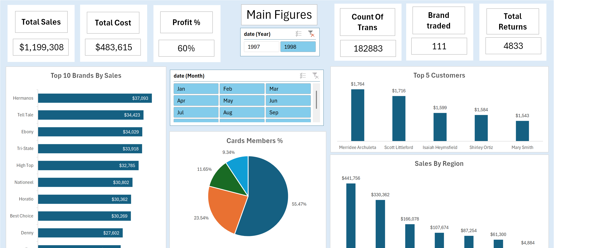
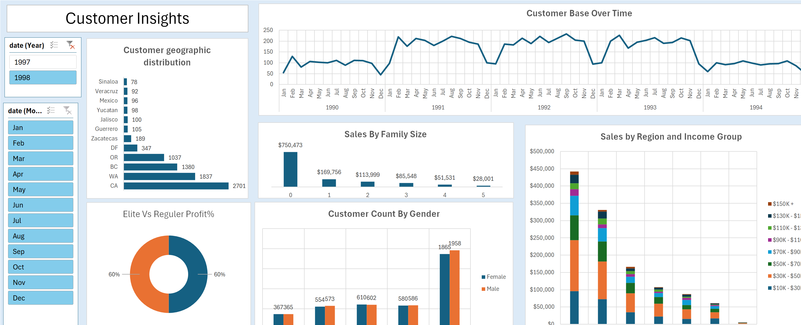
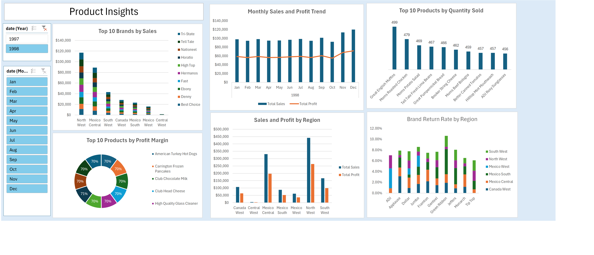

# Food Mart Retail Excel

Retail sales analysis Excel project for the **Data Analysis & Business Intelligence Diploma** at **IMP**.

## Overview

This project explores **Food Mart** retail data covering customers, stores, products, sales (1997–1998 calendar years in the source files, labelled as the 2017/2018 sales extracts in the assignment folders), and returns. Work is done in Microsoft Excel using **Power Query**, **Power Pivot** (DAX measures), and **PivotTables** / PivotCharts for demographic, product, geographic, and KPI analysis.

Included deliverables:

- `Food_Mart_Retail_Project.xlsx` — Excel workbook (Power Query / Power Pivot / PivotTables)
- `data/FoodMart/` — source CSVs (Calendar, Customers, Products, Region, Returns, Stores, Sales 2017–2018)
- `docs/Food_Mart_Retail_Analysis.docx` — project brief / analysis guide
- `docs/screenshots/` — dashboard sheet screenshots (Main Figures, Customer Insights, Product Insights)

The CSV customer and store fields are from a **sample retail dataset** (synthetic demo names and contact details), not real personal data.

## Screenshots

Dashboard sheets captured from `Food_Mart_Retail_Project.xlsx` (Excel):

| 1. Main Figures | 2. Customer Insights | 3. Product Insights |
|---|---|---|
|  |  |  |

Workbook tabs include **1. Main Figures**, **2. Customer Insights**, **3. Product Insights**, plus supporting sheets (**Cards Members**, **Top Customers**, **KPI**, **Sales By Brand**, **Sales By Region**, and chart source sheets).

## Key findings

Computed from the source CSVs under `data/FoodMart/` (joined sales × products × stores × regions):

- **269,720** sales line items; **833,489** units sold; **$1,764,546.44** revenue; **$1,052,818.78** profit (~**59.7%** margin). Matches the Power Pivot measures in the workbook (`Count Of Trans`, `Total Sales`, `Total Profit`).
- Date span in the transaction dates: **1997-01-01** to **1998-12-30**. Revenue by year: **$565,238** (1997) vs **$1,199,308** (1998).
- **8,842** distinct buying customers (of **10,281** customers on file) across **24** stores and **1,559** products.
- **Member cards (all 10,281 customers):** Bronze **5,703**, Normal **2,420**, Golden **1,198**, Silver **960**.
- **Top brands by revenue:** Hermanos (**$56,659**), Tell Tale (**$51,561**), Ebony (**$49,727**), Tri-State (**$49,348**), High Top (**$47,201**).
- **Revenue by sales region:** North West **$847,827**, Mexico Central **$330,362**, South West **$320,805**, Canada West **$107,674**.
- **By store country:** USA **$1,177,956**, Mexico **$478,916**, Canada **$107,674**.
- **By store type:** Supermarket **$789,601**, Deluxe Supermarket **$669,727**, Gourmet Supermarket **$152,980**.
- **Returns:** **8,289** units / about **$17,432** retail value across **7,087** return rows; top returned brands include Hermanos, Horatio, Tri-State, Tell Tale, Ebony.
- Among buyers, the largest income band is **$30K–$50K** (2,882); Bronze is the most common member card among buyers as well.

## Tools

- Microsoft Excel
- Power Query
- Power Pivot (DAX)
- PivotTables / PivotCharts

## How to open

1. Clone or download this repository.
2. Open `Food_Mart_Retail_Project.xlsx` in Microsoft Excel.
3. If queries need refreshing, point Power Query at the CSVs under `data/FoodMart/` (including `data/FoodMart/Sales/`).
4. Optionally open `docs/Food_Mart_Retail_Analysis.docx` for the assignment brief and focus areas.

## Credit

**Data Analysis & Business Intelligence Diploma | IMP | Expected Dec 2026**
